# Primordial

An evolution sandbox. Hundreds of small creatures, each driven by its own tiny neural network, forage, fight and reproduce in a shared world. Nobody tells them what to do and there is no fitness function. The creatures that happen to survive long enough to have children pass on their brains and bodies, with small mutations. Over a few hundred generations, real strategies appear on their own: herds of fast foragers, ambush predators, an arms race between the two. And new species, each with its own name and its own place in a live tree of life.

You watch it happen in the browser, through a microscope rendered by a custom WebGL2 engine, where every creature is drawn from its own genes: plant-eaters are round and fuzzy, hunters are long and spiky with pincers, fast swimmers grow long tails, and veterans carry scars. A narrator calls out the big moments as they happen, you can follow any creature with the camera and watch its brain fire, and you can drop meteors, grow food or change the climate while it runs.

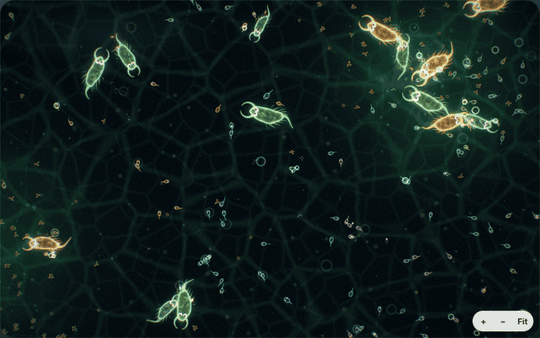

[See the whole interface in one screenshot.](docs/screenshot-full.png)

## Run it

```bash
git clone https://github.com/leahweldon/primordial && cd primordial
pip install -e .
primordial serve            # then open http://127.0.0.1:8000
```

Or with Docker:

```bash
docker build -t primordial . && docker run -p 8000:8000 primordial
```

Turn the speed up to 16× or 32×. Predators usually evolve within a minute or two, and new species start branching off soon after.

## A history of one world

Every creature starts as a plant-eater with a random brain. This is a 40,000-tick run of seed 7, reproduced exactly by `primordial run --seed 7 --ticks 40000`. The live app starts on the same seed, so if nobody interferes you'll see the same history unfold.

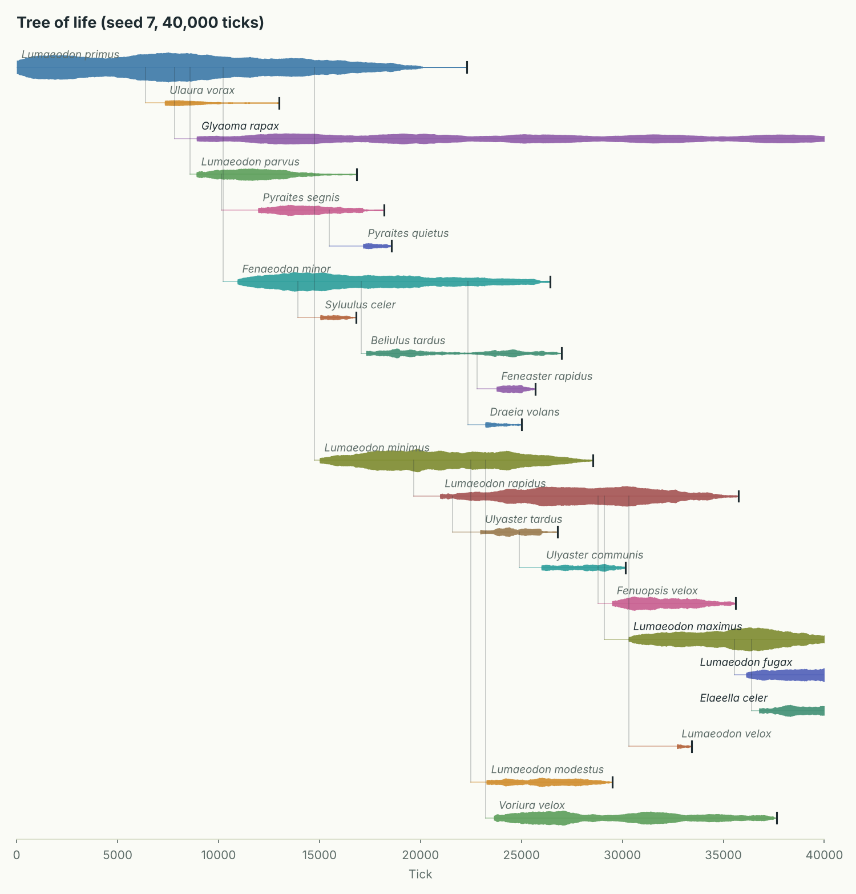

These are the narrator's own headlines from the run:

> **tick 0** Life begins: 160 creatures of *Lumaeodon primus*, plant-eaters with random brains.
>
> **tick 5,380** The first predators have evolved. 5 creatures now get most of their energy by hunting other creatures.
>
> **tick 7,330** A new species: *Ulaura vorax*, branching off from *Lumaeodon primus*. It hunts other creatures.
>
> **tick 8,910** A new species: *Glyaoma rapax*, branching off from *Lumaeodon primus*. It hunts other creatures.
>
> **tick 22,300** *Lumaeodon primus* has gone extinct after 22,300 ticks. At its peak there were 778 of them.
>
> **tick 28,910** Arms race: creatures are now 51% faster than when the first predators appeared.

Some things worth noticing in the tree and the charts below:

- **Predators evolve twice, and only one line survives.** Meat in the diet is just another heritable number. Two separate predator species split off from the founders within 1,600 ticks of each other. *Ulaura vorax* never grew past 31 and died out at tick 13,000. *Glyaoma rapax* is still hunting at tick 40,000. Around it, 19 new plant-eating species appear, and 16 of them die out again.
- **The founders are outcompeted by their own descendants.** *Lumaeodon primus* peaks at 778 and is extinct by tick 22,300, replaced by faster, smaller offshoots.
- **The prey get faster.** Once predators are established, the creatures that run survive. Average top speed climbs from 2.2 to 3.9.
- **The seasons drive boom and bust.** Plant growth swings over every 6,000-tick year, and the population follows, swinging between roughly 300 and 800.

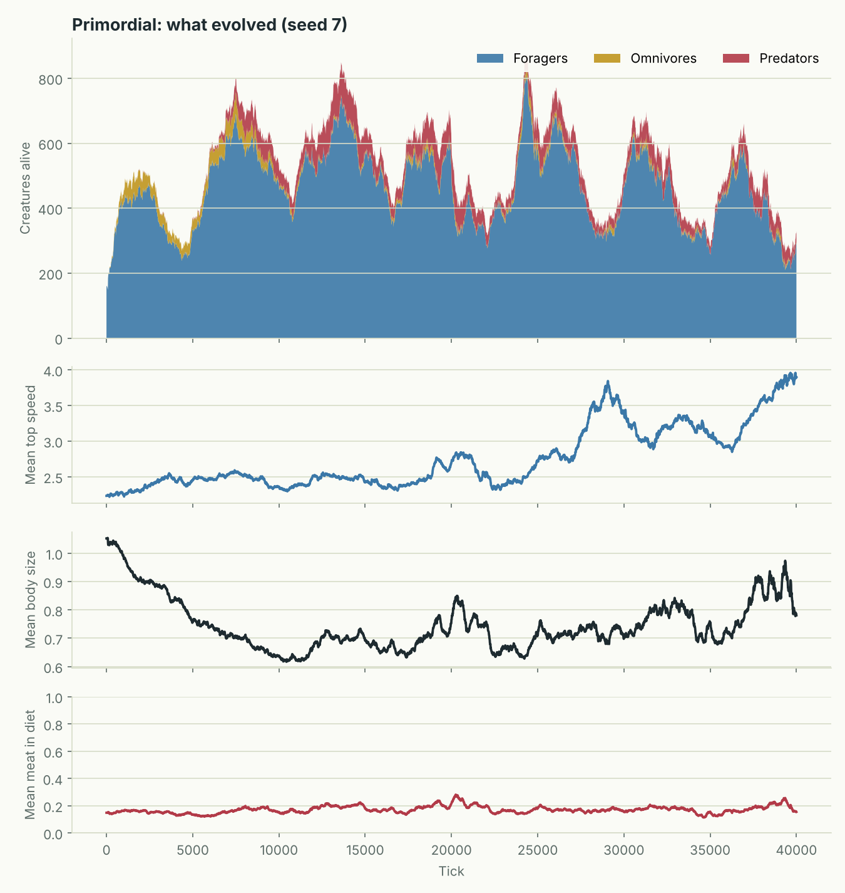

## When do predators evolve?

To find out what decides whether predators evolve, I ran 50 worlds in parallel: five levels of food supply, five bite strengths and two seeds each, for 20,000 ticks per world. That's one command, `primordial sweep`, and took 20 minutes on a 2-core VM, using 2,391 CPU-seconds of simulation (a 2.0× parallel speed-up).

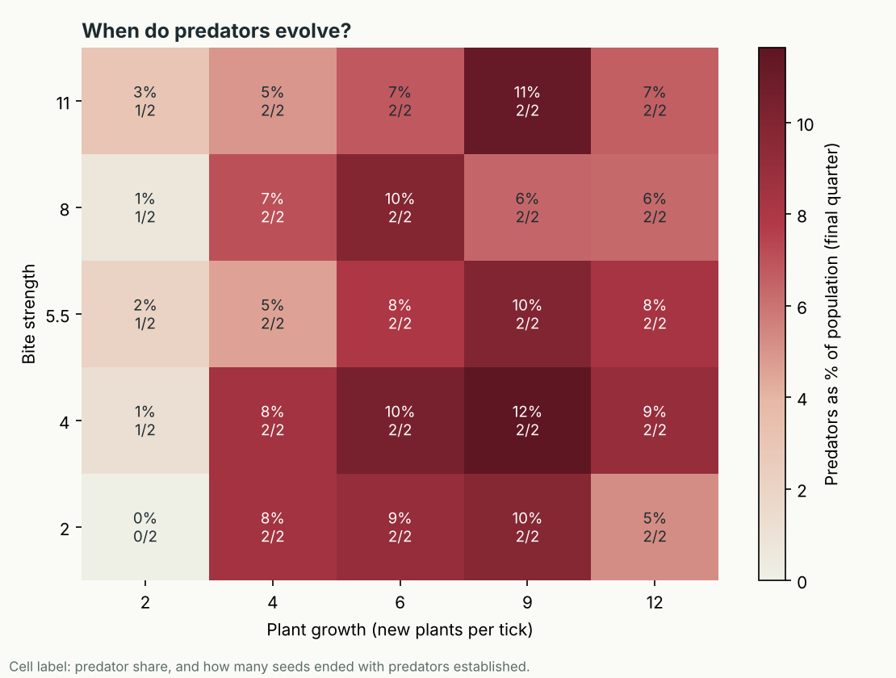

- **Food supply decides it, not weapons.** With 2 new plants per tick, predators established themselves in only 4 of 10 worlds and averaged under 3% of the population. From 4 plants per tick upwards, they established in all 40 worlds.
- **Bite strength barely matters.** Even the weakest bite produced established predators in every world with enough food. A predator only needs prey to be plentiful, not easy to kill.
- **The share peaks at 6 to 9 plants per tick (8–12%),** then dips slightly at 12, where the plant-eating population is largest.
- In 47 of the 50 worlds at least five predators appeared at some point, with a median first appearance at tick 6,530.

With two seeds per cell the exact percentages are noisy, but the jump between 2 and 4 plants per tick shows up for both seeds. The raw results are in [`docs/sweep/sweep.csv`](docs/sweep/sweep.csv).

## The creatures

Nothing in the world view is a stock sprite or an image asset. Each creature is a signed distance field evaluated per pixel on the GPU, built from its genes and its current state, so you can read its lifestyle off its body:

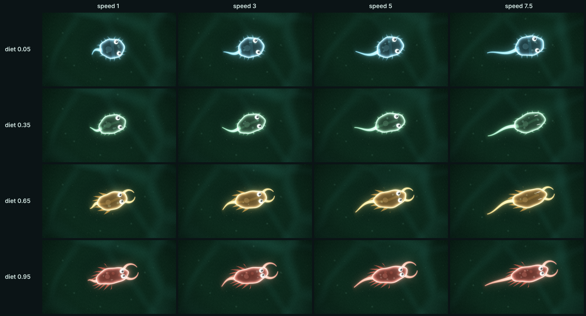

- **Diet** shapes the body plan. Grazers are round, with cilia to sweep in food and eyes on the sides to watch for danger. Hunters are long and spiky, with forward-facing eyes and a pair of pincers that snap open and shut while they bite. Omnivores sit in between.
- **Speed** makes the body sleeker and the tail longer, and the tail beats harder the faster the creature is actually swimming.
- **Size** sets the body size, and **species** sets the colour and markings (spots, bands or a stripe), so relatives look alike.
- **State** shows too: starving creatures go thin and pale, old ones fade, newborns have big eyes, and a creature ready to breed has a glowing nucleus. Hunters pick up a scar for every few kills.

The world around them is alive as well. Light ripples across the slide in caustics, plankton drifts past at two depths (the near layer out of focus), algae sway and change colour with the seasons, and the fertile oases drift across the dish as nutrient haze. Creatures pop in when they're born and dissolve when they die (red if something killed them, grey if they starved). Meteors land with a shockwave and camera shake. Switch the microscope between **dark field** (glowing, translucent bodies) and **bright field** (a classic stained slide).

| Dark field | Bright field |
| --- | --- |
| 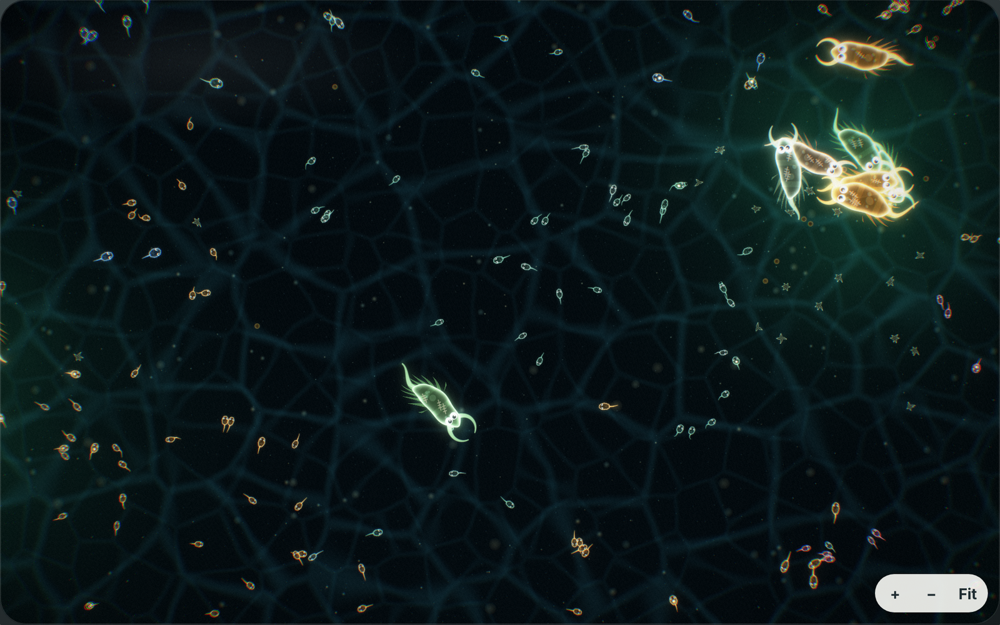 | 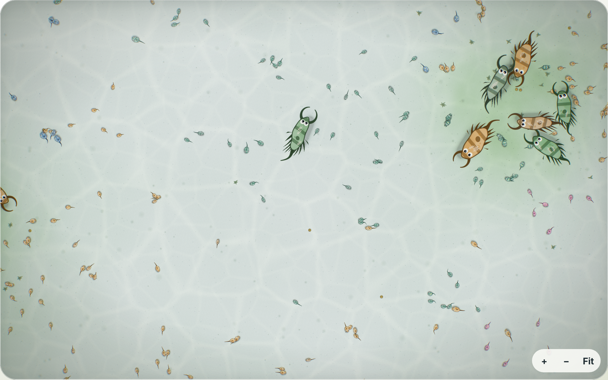 |

A field guide below the tree of life draws every living species from its genes.

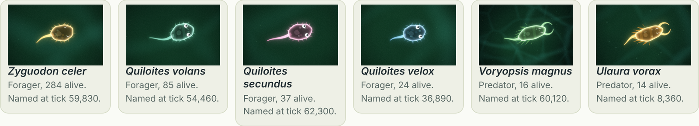

## The renderer

The world view is a WebGL2 renderer written from scratch, with no engine and no build step: a 135-line WebGL2 toolkit, hand-written GLSL, and a frame graph.

```
background pass   caustics (Voronoi edges), nutrient haze, debris      ─┐
far plankton      parallax, additive                                    │
plants            algae fronds and diatoms, one instanced draw          ├─► HDR scene (RGBA16F)
creatures         SDF bodies, one instanced draw for the whole world    │
particles         births, meals, deaths, meteors: ring buffer on GPU    │
near plankton     out of focus, over everything                        ─┘
                         │
          bright pass ─► blur ½ res ─► blur ¼ res     (bloom)
                         │
composite         shockwave distortion, chromatic aberration, bloom,
                  tone roll-off, vignette, grain                       ─► screen
```

- **One draw call per layer.** Each creature is 27 floats of instance data (previous and current position, genes, state, look), written into a grow-only buffer with no per-frame allocation. The vertex shader interpolates between server frames, so motion is smooth at any refresh rate.
- **Bodies are maths, not textures.** The fragment shader builds each creature from SDF primitives (flexing body, beating tail, cilia, spikes, pincers that open while biting, eyes that look where it's swimming), then shades it as a translucent membrane with organelles and a nucleus that glows when it's ready to breed. Anti-aliasing width is clamped to one pixel so primitives far outside the body can't smear seams across the quad.
- **HDR and bloom.** The scene renders into a half-float target, so bright nuclei and particles go past 1.0 and the bright pass picks them out for a two-level blur.
- **Graceful fallback.** Without WebGL2 the page switches to the Canvas 2D renderer from earlier versions automatically, and the browser test runs against both.

## Watch a brain think

Click any creature and the inspector shows its brain live. Each neuron glows blue or red as it fires, the connections light up with the signals flowing through them, and a label sums up what it seems to be doing: hunting, running away, heading for food, resting. Press **Follow** and the camera zooms in and tracks it around the world.

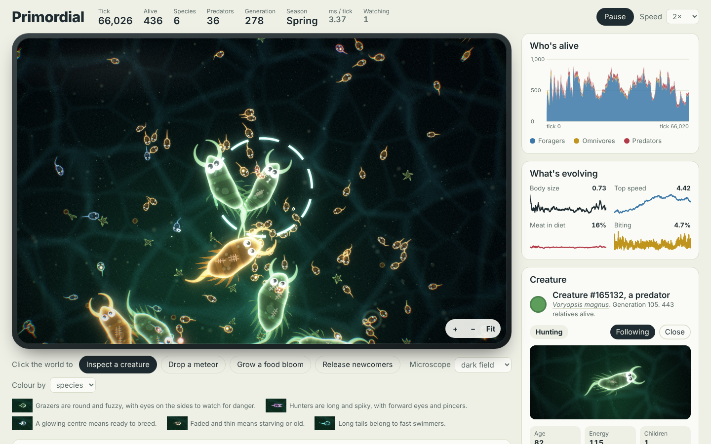

## How it works

### The world

A 1600 × 1000 torus (walk off one edge and you come back on the other). Plants grow mostly in a few fertile oases that slowly wander, so the best grazing moves around. Plant growth rises and falls with the seasons. Creatures pay energy every tick to exist (more if they are big) and to move (more if they are fast). Run out of energy and you die.

### The brains

Each creature has a two-layer neural network: 11 inputs, 8 hidden neurons, 4 outputs.

| Senses (inputs) | Actions (outputs) |
| --- | --- |
| direction and distance to the nearest plant | turn |
| direction and distance to the nearest creature | thrust |
| is that creature bigger than me? more carnivorous? | attack whatever is in reach |
| does it look like family? (heritable colour) | reproduce if I have enough energy |
| my own energy, an internal clock | |

Brains are never trained. A child gets a copy of its parent's weights, and each weight has a 12% chance of a random nudge. Body traits (size, top speed, diet, colour) mutate the same way.

### Species

Creatures reproduce on their own, so "can they interbreed?" can't define a species. Instead, each creature carries a pointer to a *reference genome*: the genome of the founder of its line. A genome here means its brain weights plus its body traits, with diet weighted heavily. When a newborn's genome is more than a set distance from its reference, it has drifted far enough to start a new species. The exception is when it is close to a sister species that split from the same parent earlier, in which case it joins that one. This is the compatibility-distance idea from [NEAT](https://nn.cs.utexas.edu/downloads/papers/stanley.ec02.pdf), adapted to a population that breeds continuously rather than in generations.

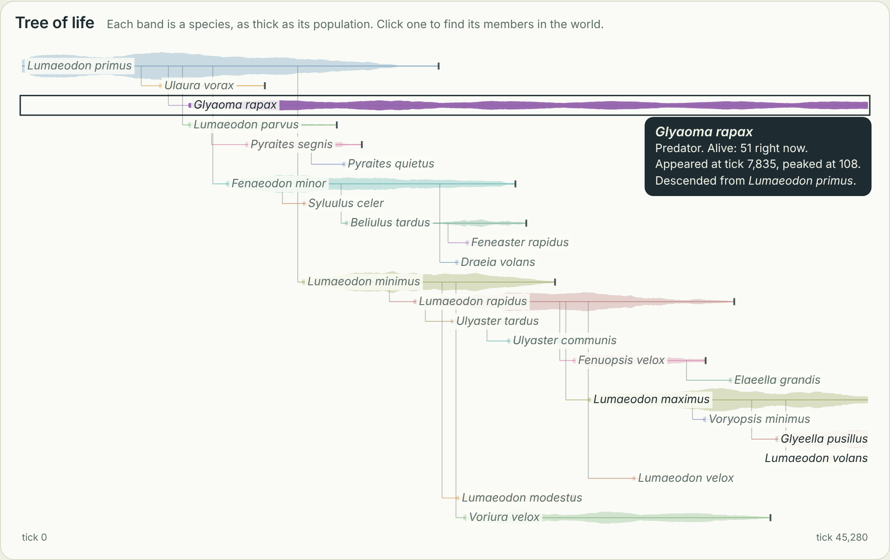

Most new species are tiny offshoots that vanish quickly. A species is only *established* once it reaches 20 living members. At that point it gets a generated Latin name: the genus is invented from syllables, and the species name describes what sets it apart from its parent (*vorax* for a new predator, *velox* for a faster one, *minimus* for a smaller one). Names come from their own seeded generator, so naming never disturbs the simulation and stays reproducible.

### The narrator

After each statistics sample, a narrator checks for moments worth reporting: a species established or gone extinct, the first predators, predators dying out or coming back, prey speeding up, population booms and crashes ("a hard winter" if it's winter), one family taking over, generation milestones. It has a cooldown per kind of news, so it doesn't repeat itself. Big moments become headlines over the world view, and everything goes in the field notes.

### Energy is conserved

Energy only enters the world through plants. When a creature has a child, it pays for the child's starting energy **and** for its body. A predator that kills something gets that body energy back, scaled by how carnivorous it is. This stops predators farming energy out of thin air by eating each other, which was the first thing evolution found when bodies were free (predators that mostly ate each other filled the world to its population cap within 20,000 ticks). A test checks that the books balance on every birth.

## Architecture

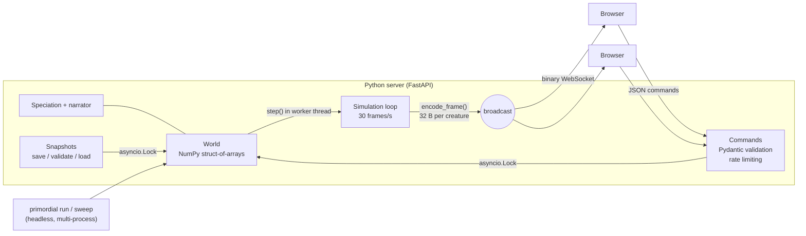

Decisions worth calling out:

- **No per-creature Python loop.** Creature state lives in one NumPy array per attribute (struct of arrays), and every brain in the world is evaluated with a single `einsum` over stacked weight tensors. The same call also returns the hidden-layer activations, which is what the live brain view shows. Births and deaths are boolean masks and concatenation.
- **Neighbour search is O(N log N).** Each tick builds periodic KD-trees (SciPy `cKDTree` with `boxsize`, so wrap-around distances are handled for free). Profiling showed tree building dominated, and switching to unbalanced, non-compacted trees made each tick about 20% faster, since the trees are thrown away every tick anyway.
- **Speciation is cheap.** Only newborns are checked, with one vectorised distance per birth against their reference genome. Reference genomes are shared by pointer and garbage-collected when no living creature refers to them.
- **One world, many viewers.** A single background task owns the world. CPU-heavy steps run in a worker thread via `asyncio.to_thread` so the server stays responsive, and an `asyncio.Lock` serialises steps, slider changes, meteors, resets and snapshot loads so nothing races. Narrated events carry sequence numbers, so each broadcast sends only what viewers haven't seen, and late joiners get the backlog.
- **Binary frames, JSON for the rest.** A frame is a 16-byte header plus 32 naturally aligned bytes per creature and 4 per plant (about 55 KB for a full world). Those 32 bytes carry everything the art needs, down to the speed gene, current thrust, age and kill count. Stats, inspector data and commands are small and infrequent, so they stay JSON.
- **Smooth at any frame rate.** The server sends up to 30 frames a second; the browser draws at the display's refresh rate and interpolates every creature's position and heading between the last two frames, taking care not to interpolate across the wrap-around edge of the world.
- **Slow viewers don't fall behind.** Each connection has its own sender task. The simulation loop only replaces that client's pending frame (latest frame wins), and the sender ships it when the client has credit: the browser acks every frame it actually draws, with at most two in flight. A slow laptop gets fewer frames, not frames from ten seconds ago, and it can't slow the simulation or other viewers down. Events and replies go through a separate bounded queue so they're never dropped in favour of world frames.
- **Fast procedural art on the fallback path.** In the Canvas 2D renderer, each creature is drawn in two layers. The parts that move every frame (tail, cilia, pincers, blinking eyes) are drawn live. The rest of the body depends only on slowly changing things, so it's rendered once into a small sprite and reused. Sprite keys quantise the genes, hunger, age and on-screen size so that similar creatures share sprites, and the cache evicts the least recently used. Detail also drops with on-screen size: tiny creatures skip cilia, markings and shading. The ground texture is cached too and only repainted when the camera, season or oases move, and the glass, vignette and frost are CSS layers, so the browser composites them for free.
- **Untrusted input is validated.** Commands are parsed with a Pydantic discriminated union, slider values are clamped to whitelisted ranges, and disasters are rate-limited per connection with a token bucket. Uploaded snapshots are size-capped, loaded with `allow_pickle=False` (no code execution), and every array's shape, type and cross-references are checked before anything is used.
- **Reproducible, even across save and load.** All randomness comes from one seeded generator, so `(config, seed)` fully determines a run. Snapshots include the generator's exact internal state, and a test checks that a saved and reloaded world continues bit-for-bit identically to the original.
- **Sweeps are embarrassingly parallel.** Each (parameters, seed) pair is an independent job in a process pool, one process per core, which sidesteps Python's GIL. Results are written to CSV as each world finishes, and a world that crashes is logged without losing the rest of the sweep.

## Performance

Single core, 2-vCPU cloud VM, Python 3.13 (`primordial bench`):

| Creatures | ms per tick | Ticks per second |
| ---: | ---: | ---: |
| 250 | 1.1 | 906 |
| 500 | 1.9 | 531 |
| 1,000 | 2.9 | 350 |
| 2,000 | 5.0 | 200 |
| 4,000 | 9.9 | 101 |

Profiling shows about three quarters of each tick goes on neighbour search. The live app caps the population at 1,500, which stays smooth at the default 4× speed; at 32× the frame rate drops but the simulation keeps up.

## Experiments without the browser

```bash
# one world, narrated in the terminal, with charts and a saved snapshot
primordial run --ticks 30000 --seed 3 --out results/famine --set plant_growth=3 --save famine.npz

# carry on from where it stopped, or open it in the browser
primordial run --load famine.npz --ticks 10000 --out results/famine-2
primordial serve --load famine.npz

# many worlds in parallel
primordial sweep --vary plant_growth=2,4,6,9,12 attack_damage=2,4,5.5,8,11 --seeds 2 --ticks 20000
```

`run` writes `history.csv` (a sample every 10 ticks: population by diet, trait averages, births, deaths, kills), `events.json` (the narration), `species.json` (the tree of life), `summary.json`, and charts of both. The live server exposes the same data at `/api/history`, `/api/species`, `/api/events` and `/api/creatures/{id}`, and you can save or load the running world at `/api/snapshot`.

## Tests

```bash
pip install -e ".[dev]"
pytest          # 66 tests
ruff check .
```

The tests cover:

- the rules of the world, using hand-wired creatures: eating, biting, kills, reproduction, energy conservation, the population cap, seasons and drifting oases
- speciation: inheriting, founding and joining species, naming, extinction, and nearest named ancestors
- the narrator's triggers and cooldowns
- determinism, including across save and load
- snapshot validation against tampered and malicious files
- the binary protocol, command validation, frame flow control, the parallel sweep, and the WebSocket and HTTP server end to end
- a real-browser smoke test (Playwright and Chromium), run once with the WebGL2 renderer and once with the Canvas fallback, that loads the page, waits for creatures to be drawn, opens the inspector and fails on any JavaScript error or shader compile error. It's skipped if Playwright isn't installed.

CI runs the tests on Python 3.11 to 3.13, runs the browser test in its own job, then builds the Docker image and probes its health check.

## Project layout

```
src/primordial/
  world.py        the simulation: sense, think, eat, fight, move, reproduce, die, seasons
  brain.py        batched neural networks and mutation
  population.py   struct-of-arrays creature storage
  species.py      speciation, the species registry and the census
  names.py        Latin names for new species
  narrator.py     spots and writes up the moments worth noticing
  analytics.py    what's evolving: per-sample statistics
  persistence.py  save and load worlds (validated, no pickle)
  sweep.py        parallel parameter sweeps and the phase diagram
  protocol.py     binary frame format and command schemas
  server.py       FastAPI app, simulation loop, WebSocket broadcasting, snapshots
  cli.py          serve / run / sweep / bench
  web/            the browser client (no build step, no framework)
    gl/glkit.js   tiny WebGL2 toolkit: programs, instanced buffers, render targets
    gl/shaders.js all the GLSL: background, plants, creatures, particles, plankton, bloom, composite
    gl/renderer.js the frame graph: scene passes, bloom chain, composite
    world-gpu.js  game feel: instances, particles, shockwaves, shake, seasons, GPU portraits
    art.js        the Canvas 2D fallback renderer and its sprite cache
    app.js        networking, flow control, camera, rendering loop, charts, tree of life, inspector
tests/
docs/             screenshots, the seed 7 run, the sweep, benchmark output
```

## What's next

- **Distributed simulation.** Split the torus into tiles owned by separate worker processes that exchange creatures crossing a border, so worlds can grow far past what one core handles.
- **Sexual reproduction** with crossover, which would let species be defined by who can actually breed together.
- **Recurrent brains**, so creatures can remember where food was.
- **Replays**: record the seed plus the timeline of user events and play any run back exactly.

See [CHANGELOG.md](CHANGELOG.md) for what changed between versions.

## Licence

MIT
